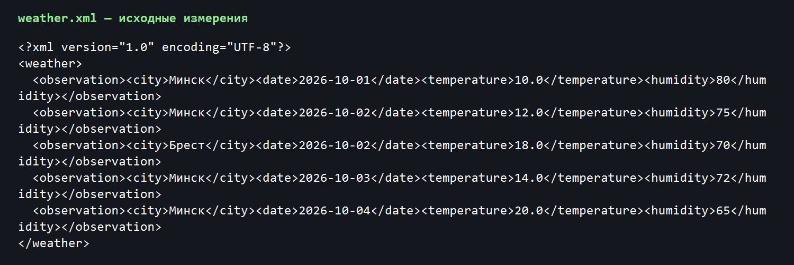
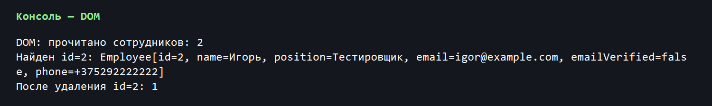
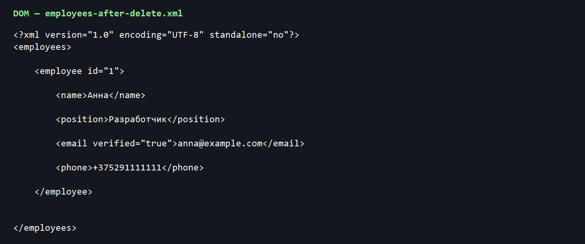
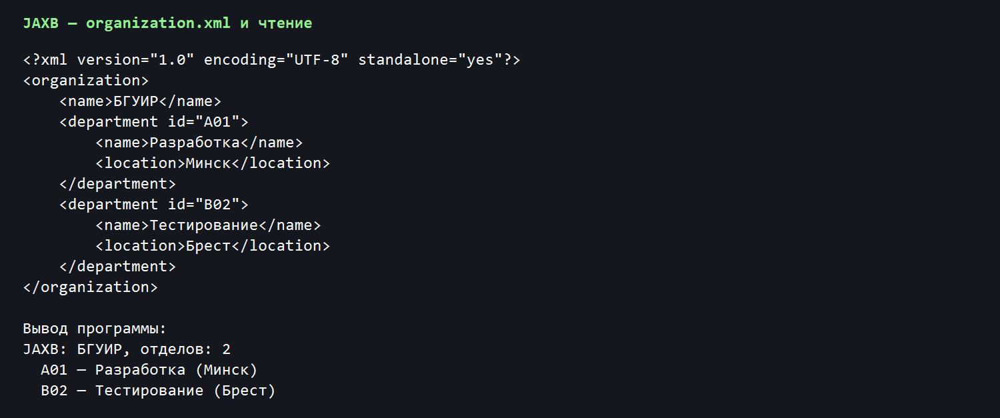
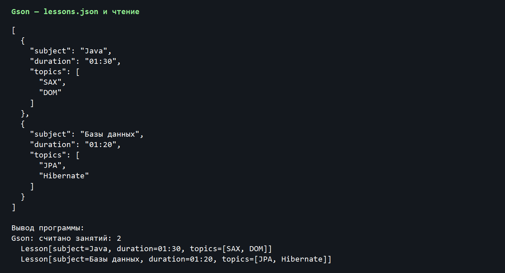

# Лабораторная работа №3 «Marshalling»

**Цель работы.** Изучить способы преобразования XML и JSON в объекты Java и обратно; освоить событийный SAX-парсер, объектную модель DOM, JAXB и библиотеку Gson.

**Задание.** Для SAX выполнить вариант 8: обработать XML с данными о погоде (город, дата, температура, влажность) и определить среднюю температуру за указанный период для выбранного города. Для DOM расширить класс Employee несколькими полями и добавить атрибут к одному из тегов, после чего обеспечить запись, чтение, поиск и удаление. Для JAXB создать Organization со списком Department и реализовать запись и чтение XML. Для Gson записать массив объектов Lesson в JSON и считать его обратно.

## 1. Теоретические сведения

### 1.1. Парсинг и представление данных

Парсер преобразует последовательность символов в структуру, с которой может работать программа. При обработке XML необходимо учитывать вложенность элементов, атрибуты и текстовые значения; при обработке JSON — объекты, массивы и типы полей. В этой работе используются четыре подхода. SAX и DOM входят в стандартные средства Java для XML, JAXB связывает XML с классами Java, а Gson работает с JSON. Их сравнение помогает выбрать инструмент по характеру задачи: чтение большого файла, изменение документа или обмен готовыми объектами.

### 1.2. SAX

SAX (Simple API for XML) читает XML последовательно и сообщает обработчику о начале элемента, фрагменте текста и конце элемента. Обработчик наследуется от DefaultHandler и переопределяет методы startElement, characters и endElement. Поскольку документ не строится целиком в памяти, такой способ удобен для потоковой обработки. При этом невозможно свободно переходить к ранее прочитанному узлу: нужные сведения приходится сохранять в собственных структурах.

Вызов characters не обязан содержать весь текст тега сразу, поэтому фрагменты накапливаются в StringBuilder. Дата преобразуется в LocalDate, температура — в double, влажность — в int. Для вычисления среднего отбираются только записи нужного города, дата которых попадает в интервал включительно. Если записей нет, программа сообщает об отсутствии данных вместо деления на ноль.

### 1.3. DOM

DOM (Document Object Model) представляет XML как дерево узлов. К элементам можно обращаться по имени, читать и изменять их содержимое, добавлять атрибуты и удалять записи. Это удобно, когда требуется не только прочитать документ, но и изменить его. Недостаток DOM — хранение дерева документа в памяти, поэтому для очень крупных файлов потоковый SAX обычно экономнее.

В данной работе у Employee есть поля id, name, position, email, phone; у тега email дополнительно установлен атрибут verified. После создания документа программа считывает его снова с диска, ищет сотрудника по id и сохраняет результат удаления в отдельный файл. Так проверяются запись, чтение и изменение, а не только построение XML в памяти.

### 1.4. JAXB

JAXB (Java Architecture for XML Binding) выполняет маршалинг — преобразование объекта Java в XML — и анмаршалинг, то есть обратное преобразование. Аннотации задают корневой элемент, отображение полей и XML-атрибутов. В работе Organization выступает корневым объектом и содержит список Department. Для чтения XML JAXB создаёт объекты, поэтому у моделей предусмотрены конструкторы без аргументов.

### 1.5. Gson

Gson сериализует объекты Java в JSON и восстанавливает их из JSON. Для списка Lesson при чтении требуется указать полный тип List<Lesson> через TypeToken: без него тип элементов может быть восстановлен некорректно. Поле LocalTime хранит длительность занятия; для его преобразования в строку формата HH:mm и обратно зарегистрированы собственные сериализатор и десериализатор.

## 2. Реализация задания

### 2.1. SAX: средняя температура, вариант 8

Исходный файл weather.xml содержит пять измерений. Четыре относятся к Минску, одно — к Бресту. Для проверки выбран период с 1 по 3 октября 2026 года. Измерение Минска за 4 октября выходит за границу интервала, а измерение Бреста не подходит по городу. Поэтому в расчёте остаются температуры 10, 12 и 14 °C; среднее арифметическое равно (10 + 12 + 14) / 3 = 12 °C. Входные данные показаны на рисунке 1.

Класс WeatherSaxHandler формирует объекты WeatherRecord по событиям SAX. Класс SaxDemo фильтрует готовые записи по городу и датам и вычисляет среднее с помощью числового потока. Город и границы периода можно передать аргументами запуска; значения по умолчанию соответствуют проверочному примеру. Результат приведён на рисунке 2.

### 2.2. DOM: работа с сотрудниками

Для двух сотрудников программа создаёт employees.xml. Новый тег phone содержит номер телефона, а email содержит адрес и атрибут verified со значением true или false. Затем файл открывается повторно. Программа восстанавливает обе записи Employee, находит запись с id=2 и удаляет соответствующий XML-узел. Количество записей уменьшается с двух до одной; результаты чтения и поиска показаны на рисунке 3.

Исходный и изменённый документы сохраняются раздельно. Это позволяет сравнить их после выполнения программы и убедиться, что удалён именно сотрудник с id=2, а дополнительное поле и атрибут другого сотрудника сохранились. Содержание исходного файла и результат удаления представлены на рисунках 4 и 5.

### 2.3. JAXB: организация и подразделения

Объект Organization с именем «БГУИР» содержит два подразделения. Поле departments размечено как повторяющийся элемент department; идентификатор отдела записывается в XML-атрибут id. После маршалинга файл organization.xml считывается анмаршалером. Вывод имени организации, количества отделов и их данных подтверждает восстановление структуры. XML и консольный результат приведены на рисунке 6.

### 2.4. Gson: массив занятий

Созданы два занятия: Java и «Базы данных». Каждое хранит название предмета, длительность и список тем. Gson записывает их в массив JSON, затем читает файл lessons.json и восстанавливает список объектов Lesson. В выводе отображаются оба предмета, время и темы; это показывает, что коллекции и LocalTime обработаны корректно. Файл и результат представлены на рисунке 7.

## 3. Проверка работы

Проект собран на JDK 21 командой `mvn clean compile exec:java`. Для SAX сверено ожидаемое значение 12,00 °C с результатом программы. Для DOM проверены чтение двух сотрудников, нахождение id=2 и наличие одной записи после удаления. Для JAXB проверено восстановление двух отделов, для Gson — двух занятий. Все файлы результатов создаются в target/lr3-output; Maven завершает запуск сообщением BUILD SUCCESS.

## 4. Вывод

В ходе работы реализованы четыре способа обработки данных. SAX использован для последовательного чтения погодных измерений, DOM — для изменения XML-дерева, JAXB — для преобразования объекта организации в XML и обратно, Gson — для сохранения коллекции занятий в JSON. Практическая проверка подтвердила правильность фильтрации по периоду, изменения XML и восстановления объектов после чтения файлов.

## Использованные материалы

Методические указания к лабораторной работе №3 «Marshalling» по дисциплине «Современные технологии серверной разработки». Пример отчёта, предоставленный вместе с заданием.
