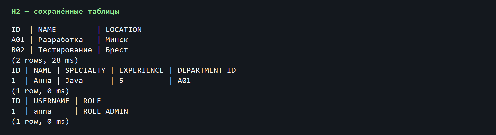

# Лабораторная работа №4 «Управление персистентностью на основе JPA (Hibernate)»

**Цель работы.** Познакомиться с персистентными объектами, отображением классов Java на таблицы реляционной базы данных и выполнением операций с данными средствами JPA и Hibernate.

**Задание.** Дописать операции в части методических указаний «Отношения между таблицами»: поиск, добавление и удаление отдела, перевод сотрудника в другой отдел и поиск пользователя по имени. Реализовать три собственных SELECT-запроса к таблицам. Для данной лабораторной работы отдельный номер варианта не предусмотрен.

## 1. Теоретические сведения

### 1.1. Персистентность, JPA и ORM

Персистентным называют объект, данные которого сохраняются после завершения программы. Обычный объект Java существует в памяти процесса; сведения о нём исчезают вместе с процессом, если их не записать во внешнее хранилище. Реляционная база данных позволяет сохранять сведения в таблицах и обращаться к ним при последующих запусках приложения. В этой работе базой служит локальный файл H2.

JPA (Java Persistence API) описывает общие правила работы с сущностями и их отображения на таблицы. Hibernate реализует эти правила. Технология ORM (Object-Relational Mapping) связывает поля объекта со столбцами, объект сущности — со строкой таблицы, а ссылки между объектами — с внешними ключами. Благодаря ORM основные операции можно писать на уровне классов Java, не формируя вручную SQL для каждого добавления или изменения записи.

### 1.2. Отображение сущностей

Класс сущности помечается @Entity, таблица может быть задана через @Table, а первичный ключ — через @Id. Для разработчика идентификатор формируется автоматически с помощью @GeneratedValue. Названия и ограничения отдельных столбцов определяются аннотациями @Column. Эти настройки описывают, как Hibernate должен преобразовывать экземпляры классов в записи базы данных.

Методические указания рассматривают два способа настройки отображения: отдельные XML-файлы и аннотации в исходном коде. В выполненном проекте использованы аннотации. Это позволяет увидеть связи и ограничения непосредственно в классах Department, Developer и UserAccount. Для учебного сценария такой вариант делает структуру модели наглядной и сокращает число конфигурационных файлов.

### 1.3. Связи между таблицами

Один отдел может содержать нескольких сотрудников, поэтому связь Department → Developer имеет вид «один ко многим». Каждый сотрудник относится к одному отделу — обратная связь «многие к одному». У сотрудника может быть одна учётная запись, что выражается связью «один к одному». В UserAccount применена аннотация @MapsId: первичный ключ аккаунта совпадает с ключом сотрудника, которому он принадлежит.

Удаление отдела по заданию должно затрагивать связанных сотрудников. Для этого у коллекции сотрудников настроены каскадные операции. В модели также настроено каскадное удаление аккаунта сотрудника. Таким образом, удаление временного отдела не оставляет строк с внешними ключами на отсутствующие сущности. В рабочем приложении такую операцию следовало бы защищать дополнительным подтверждением; здесь она демонстрируется на специально созданных временных данных.

### 1.4. Сессия, транзакция и запросы

Session представляет сеанс работы Hibernate с базой данных. Изменения выполняются внутри транзакции: при успешном завершении вызывается commit, при ошибке — rollback. Это помогает не оставлять базу в частично изменённом состоянии. После чтения лениво загружаемой связи сессия уже может быть закрыта; поэтому необходимые связанные данные выбираются заранее с помощью JOIN FETCH.

HQL — язык запросов Hibernate, который обращается к именам сущностей и их полям, а не непосредственно к названиям таблиц. Параметры передаются через setParameter: это отделяет значения от текста запроса. В работе используются три SELECT-запроса: отделы определённого города, сотрудники с опытом не меньше заданного значения и сотрудники указанного отдела. Ещё один запрос с JOIN FETCH получает отделы вместе с сотрудниками за одно обращение и предотвращает последовательность дополнительных запросов при обходе коллекций — проблему N+1.

## 2. Подготовка проекта и модели данных

Проект создан как Maven-приложение для JDK 21. Подключены Hibernate ORM 6.6.8.Final и H2 2.4.240. В методичке для примера используется MySQL; в выполненной работе применена файловая H2, чтобы база создавалась при обычном запуске проекта и не требовала отдельной установки сервера, логина, пароля или контейнера. Файл базы располагается в target/lr4-db.mv.db и не входит в исходный код.

Основные классы модели — Department, Developer и UserAccount. Department хранит идентификатор, название и местоположение, Developer — имя, специализацию, опыт и ссылку на отдел, UserAccount — имя пользователя, пароль, роль и ссылку на сотрудника. Перечисление UserRole задаёт возможные роли. За настройку SessionFactory и границу транзакции отвечает HibernateUtil. Классы DepartmentDao, DeveloperDao и UserDao разделяют операции доступа к данным по сущностям.

При первом запуске Hibernate создаёт таблицы и в них добавляются два отдела, сотрудник Анна и её учётная запись anna. Повторный запуск не дублирует начальные записи. Для демонстрации перевода и удаления программа создаёт временные записи, а затем очищает их. Это позволяет повторять сценарий без ручной подготовки базы.

## 3. Выполнение задания

### 3.1. Поиск, добавление и перевод

DepartmentDao.findDepartmentById использует идентификатор отдела для чтения записи. Метод addDepartment сохраняет новый отдел внутри транзакции. DeveloperDao.updateDevelopersDepartment загружает сотрудника и целевой отдел, проверяет, что оба существуют, и меняет ссылку на отдел. Поскольку сотрудник находится под управлением текущей сессии, Hibernate записывает изменение при commit. UserDao.getUserByUsername выполняет параметризованный запрос и одновременно выбирает связанного сотрудника.

В проверочном запуске найден отдел A01 и учётная запись anna. Сотрудник Игорь создан в отделе A01, а затем переведён в B02. Повторный поиск показывает отдел B02, что подтверждает сохранение новой связи. Консольный результат показан на рисунке 1.

### 3.2. Три собственных SELECT-запроса

Первый запрос выбирает отделы, расположенные в Минске: в исходных данных это отдел A01. Второй запрос выбирает сотрудников с опытом не менее трёх лет: в наборе данных условию соответствует Анна с опытом пять лет. Третий запрос выбирает сотрудников отдела B02: после перевода это Игорь. Результаты трёх запросов собраны на рисунке 2.

Отдельно проверено чтение связанных данных: запрос `select distinct d from Department d left join fetch d.developers` сразу получает отделы с коллекциями сотрудников. Результат показывает Анну в A01 и Игоря в B02. Такой подход избавляет от необходимости открывать отдельную сессию для каждого отдела. Полученный список представлен на рисунке 3.

### 3.3. Каскадное удаление

Для безопасной демонстрации создаётся временный отдел T03, сотрудник Олег и его аккаунт temporary. После вызова DepartmentDao.deleteDepartment выполняются три повторных поиска. Все они возвращают null: отдел, сотрудник и аккаунт отсутствуют. Это показывает, что каскадные связи настроены последовательно и в базе не осталось зависимых записей. Вывод проверки приведён на рисунке 4.

## 4. Проверка содержимого базы данных

После работы программы таблицы были прочитаны напрямую инструментом командной строки H2. В departments сохранились A01 и B02, в developers — только Анна, в users — её учётная запись. Игорь и временный отдел с зависимыми данными удалены после демонстрации. Содержимое таблиц показано на рисунке 5. Такая проверка подтверждает, что наблюдаемый вывод программы соответствует сохранённому состоянию базы, а не только объектам в памяти.

Проект проверен стандартной командой `mvn clean compile exec:java` на JDK 21. Maven завершил сборку сообщением BUILD SUCCESS. Отдельные операции поиска, выборки, перевода и удаления дали ожидаемые результаты. Все необходимые настройки базы находятся в коде проекта, поэтому для повторения проверки достаточно установить JDK и Maven и выполнить команду из README.md.

## 5. Вывод

В ходе лабораторной работы изучено отображение связанных Java-сущностей на таблицы базы данных с помощью аннотаций JPA и Hibernate. Реализованы поиск, добавление и удаление отдела, перевод сотрудника и поиск пользователя по имени; выполнены три собственных SELECT-запроса. Проверка на файловой базе H2 подтвердила работу транзакций, связей, выборок и каскадного удаления. Использование локальной базы делает проект воспроизводимым без дополнительных внешних параметров.

## Использованные материалы

Методические указания к лабораторной работе №4 «Управление персистентностью на основе JPA (Hibernate)» по дисциплине «Современные технологии серверной разработки». Пример отчёта, предоставленный вместе с заданием.
